<p align="center"><a href="README.md">English</a> | <b>Español</b></p>

<p align="center">
  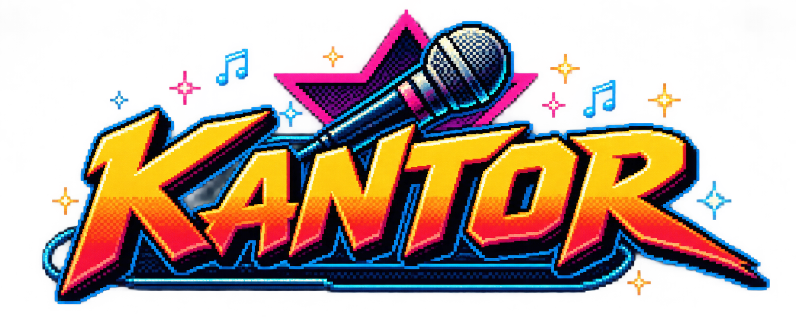
</p>

<p align="center">
  <b>Cantá como si nadie te escuchara. Nosotros estamos midiendo.</b>
</p>

<p align="center">
  Karaoke local para Windows, compatible con canciones UltraStar.<br>
  Puntuación de tono en tiempo real, hasta cuatro micrófonos a la vez. Sin cuenta, sin nube, sin internet.
</p>

<p align="center">
  
  
  
  
</p>

---

## Qué es

Kantor es un karaoke de escritorio hecho en C# / .NET 10 / WPF para cantar en casa con amigos. Lee las
canciones en formato **UltraStar** (`.txt` + audio y, si existe, video), puntúa lo que cantás en tiempo real y
guarda el historial de cada jugador. Todo funciona en tu PC: sin cuentas, sin nube, sin internet. Sin excusas.

Tiene una interfaz propia de estilo arcade de 16 bits, pensada para verse bien en una pantalla grande y manejarse
con teclado, mouse o el control remoto opcional.

Kantor no puede enseñarte a cantar. Pero puede documentar el intento.

## Características

- **Biblioteca de canciones UltraStar** desde las carpetas que elijas. Nunca modifica tus archivos. TXT, audio y
  video opcional.
- **Puntuación en tiempo real** por beat, con detección de tono mediante YIN. Notas normales, doradas, rap y
  freestyle, tres dificultades y bono de línea.
- **Hasta cuatro micrófonos simultáneos**, cada uno con su jugador, su carril y su señal de entrada en pantalla.
  Cuatro micrófonos, cuatro oportunidades de poner a prueba la autoestima.
- **Duetos** con una voz por jugador.
- **Mensajes variables por frase** mientras cantás ("¡PERFECTO!", "¡UPS!"…), en español e inglés.
- **Jugadores, partidas, historial y rankings** guardados localmente (SQLite). La memoria es selectiva, pero la
  base de datos no.
- **Resultados con comentarios y personajes**: cada actuación recibe su veredicto y un personaje de cuerpo entero
  en el escenario.
- **Avatares**: elegí uno de la galería o cargá los tuyos, con recorte de la cara.
- **Cola de canciones** y **vista previa** al navegar la biblioteca.
- **Video de fondo** si la canción lo trae.
- **Audio**: motor de Windows (WASAPI) o ASIO, con calibración de latencia (retardo de voz).
- **Control remoto opcional** mediante una integración local (pipe con nombre, solo para el usuario actual),
  apagada por omisión. Está pensada para [Avyn](docs/AVYN_CONTRATO.md), un proyecto aparte.
- **Acceso de invitados por tu red local** (apagado por omisión): un QR en el menú principal y en la lista de
  canciones permite que los invitados busquen canciones, elijan quién canta y las sumen a la cola desde el
  celular. Nada más. Cómo funciona y sus límites en [docs/INVITADOS.md](docs/INVITADOS.md): HTTP sin cifrar en tu
  red local, clave de acceso compartida, sin internet.

## ¿Por qué existe esto?

Kantor empezó porque su autor quería un karaoke que funcionara bien con sus micrófonos.

Después aparecieron el scoring, la sincronización, los jugadores, los rankings, los personajes, los avatares, las
estadísticas y el control remoto. En algún momento, una herramienta bastante sencilla empezó a convertirse en un
videojuego arcade.

No hubo ninguna reunión en la que se aprobara semejante crecimiento. Simplemente ocurrió.

## Requisitos

- Windows 10 u 11, 64 bits.
- Uno o más micrófonos para cantar (se puede explorar la biblioteca y mirar sin ellos).
- Tus propias canciones en formato UltraStar. Kantor **no incluye canciones**. El talento musical es opcional.

## Capturas de pantalla

<table>
  <tr>
    <td width="50%" align="center"><a href="docs/screenshots/es/menu.png">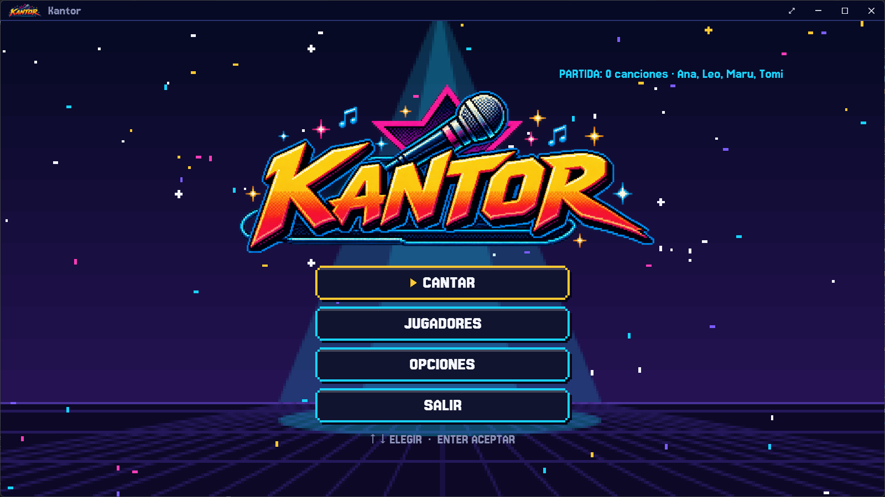</a><br><sub>Menú principal</sub></td>
    <td width="50%" align="center"><a href="docs/screenshots/es/library.png">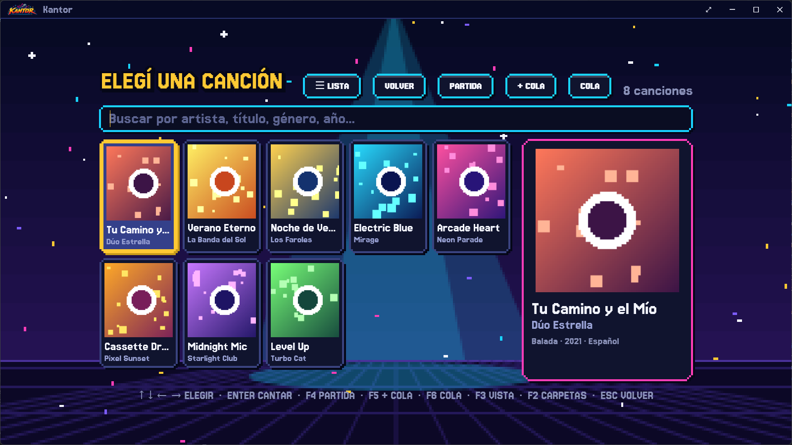</a><br><sub>Biblioteca de canciones</sub></td>
  </tr>
  <tr>
    <td width="50%" align="center"><a href="docs/screenshots/es/who-sings.png">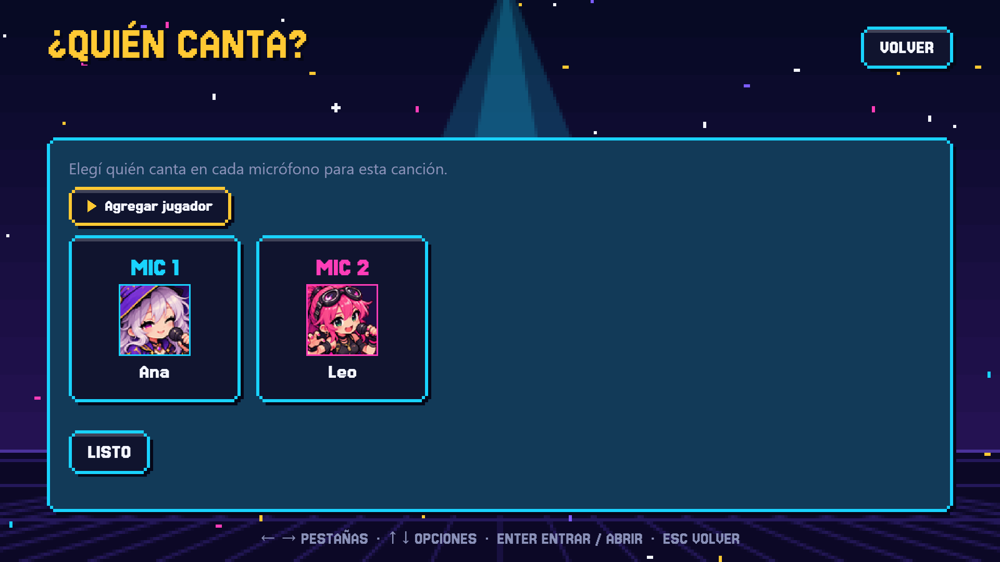</a><br><sub>Quién canta en cada micrófono</sub></td>
    <td width="50%" align="center"><a href="docs/screenshots/es/stage.png">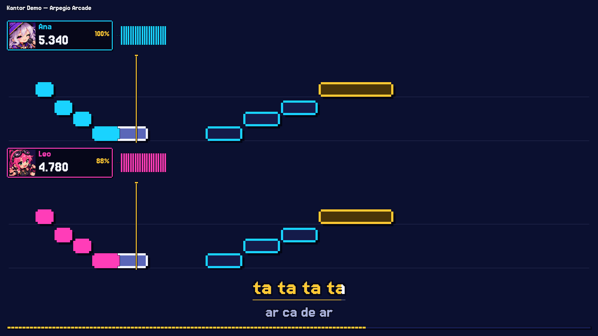</a><br><sub>Pantalla de canto con mensajes por frase</sub></td>
  </tr>
  <tr>
    <td width="50%" align="center"><a href="docs/screenshots/es/results.png">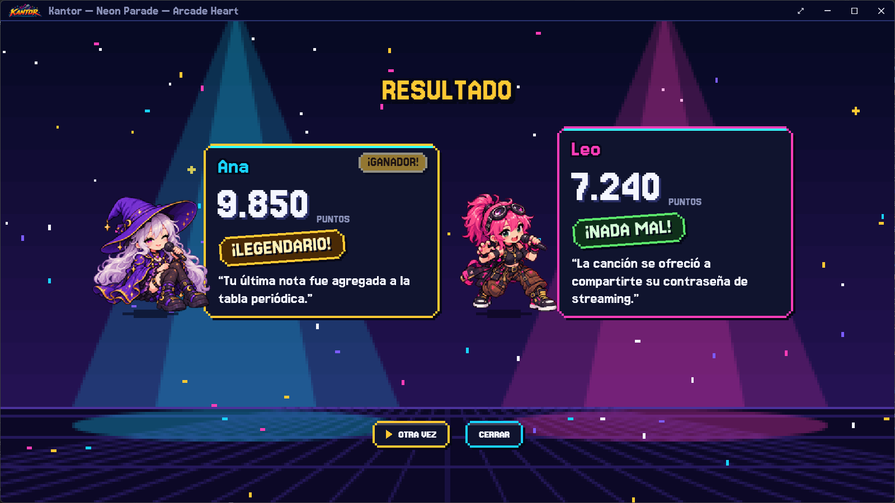</a><br><sub>Resultados con personajes y veredictos</sub></td>
    <td width="50%" align="center"><a href="docs/screenshots/es/avatars.png">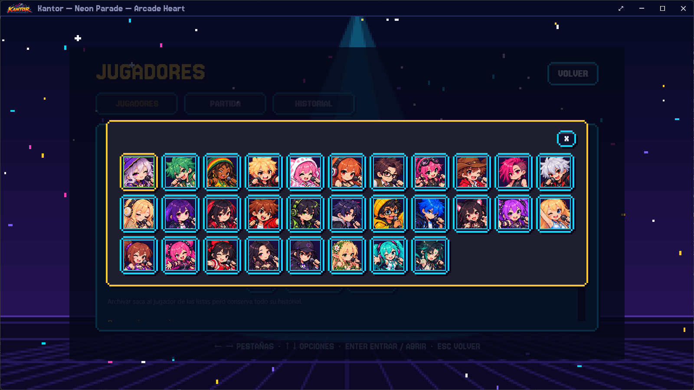</a><br><sub>Selector de avatares</sub></td>
  </tr>
  <tr>
    <td width="50%" align="center"><a href="docs/screenshots/es/guests-library.png">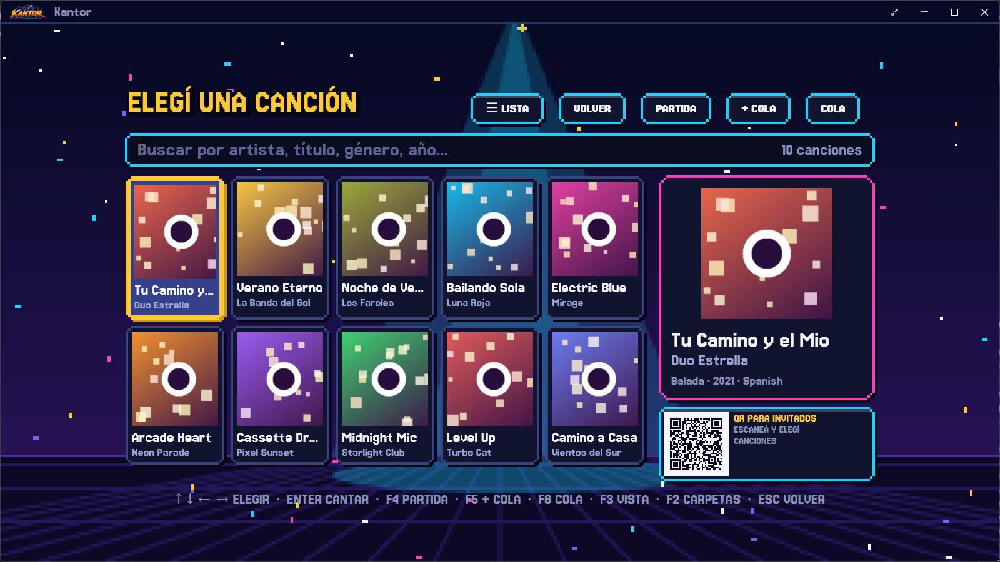</a><br><sub>QR de invitados en la lista de canciones</sub></td>
    <td width="50%" align="center"><a href="docs/screenshots/es/guests-menu.png">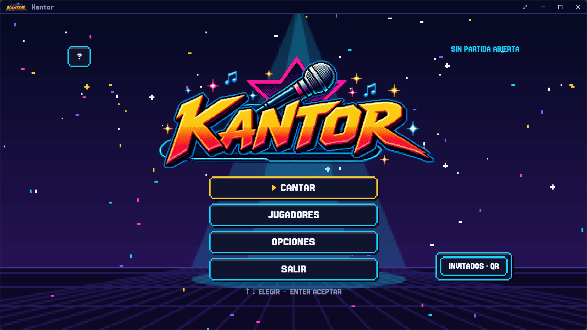</a><br><sub>QR de invitados en el menú principal</sub></td>
  </tr>
  <tr>
    <td width="50%" align="center"><a href="docs/screenshots/es/guests-phone-list.png">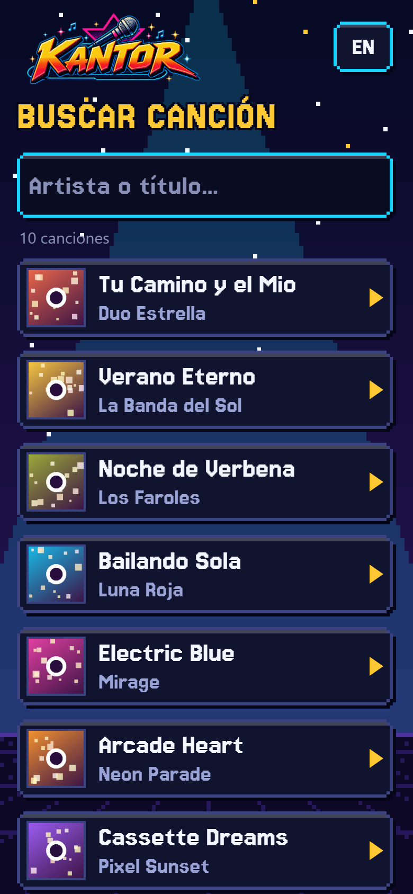</a><br><sub>En el celular: buscar una canción</sub></td>
    <td width="50%" align="center"><a href="docs/screenshots/es/guests-phone-singers.png">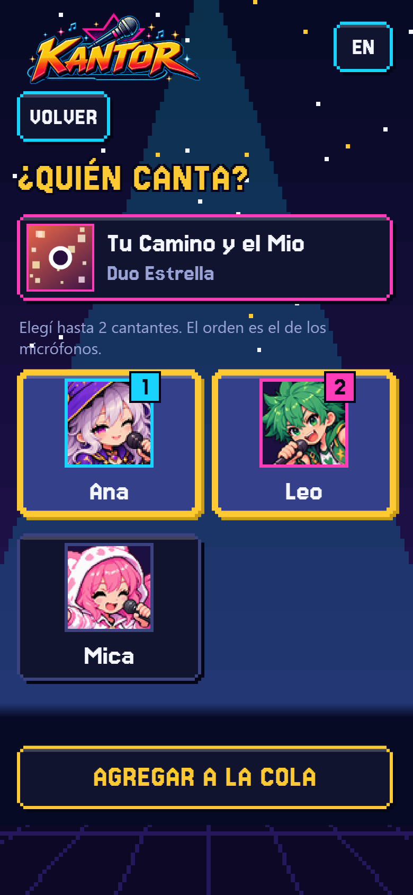</a><br><sub>En el celular: elegir quién canta</sub></td>
  </tr>
</table>

<sub>Hacé clic en una imagen para verla en tamaño completo. Las capturas usan canciones y jugadores de demostración propios, con cantantes simulados.</sub>

## Descargar

Los paquetes se publican en [Releases](../../releases). No hace falta instalar .NET:

- **Instalador** (`Kantor-Setup-<versión>.exe`): instala para el usuario actual, sin permisos de administrador,
  crea el acceso en el menú Inicio y se desinstala desde *Aplicaciones instaladas*. Ejecutar un instalador más
  nuevo encima actualiza Kantor y conserva tus datos.
- **Portable** (`Kantor-<versión>-win-x64.zip`): descomprimí en cualquier carpeta y ejecutá `Kantor.App.exe`.

> Todavía no hay una versión publicada; la página de Releases la va a listar cuando exista.
>
> El ejecutable no está firmado digitalmente, así que Windows SmartScreen puede mostrar un aviso la primera vez.
> Si lo descargaste desde la página de Releases de este repositorio, elegí "Más información" → "Ejecutar de todas formas".

## Compilar desde el código

Necesitás el [SDK de .NET 10](https://dotnet.microsoft.com/download).

```powershell
dotnet build Kantor.sln
dotnet test  Kantor.sln
dotnet run --project src/Kantor.App
```

Para armar los paquetes distribuibles (carpeta + zip en `dist\`, y el instalador con `-Installer`, que necesita
[Inno Setup 6](https://jrsoftware.org/isinfo.php)):

```powershell
powershell -ExecutionPolicy Bypass -File scripts\publish.ps1 -Installer
```

Los PNG de los avatares de fábrica no están en el repositorio: sin ellos la aplicación funciona y muestra un
avatar genérico. Más detalle en [docs/DISTRIBUCION.md](docs/DISTRIBUCION.md).

## Documentación

| Documento | Contenido |
|---|---|
| [docs/ESTADO.md](docs/ESTADO.md) | Estado del proyecto, decisiones, mediciones, pendientes y trampas |
| [docs/PUNTUACION_WORLDPARTY.md](docs/PUNTUACION_WORLDPARTY.md) | Cómo puntúa WorldParty y qué sigue Kantor |
| [docs/DISTRIBUCION.md](docs/DISTRIBUCION.md) | Cómo se arma el paquete y el camino a la Microsoft Store |
| [docs/AVYN_CONTRATO.md](docs/AVYN_CONTRATO.md) | Protocolo del control remoto Avyn |
| [docs/INVITADOS.md](docs/INVITADOS.md) | Acceso de invitados por LAN: uso, qué se permite, seguridad y límites |

## Licencia y marca

Copyright (C) 2026 Pablo Pramparo

El **código** de Kantor es software libre: podés redistribuirlo y/o modificarlo bajo los términos de la
Licencia Pública General de GNU, versión 3 o (a tu elección) cualquier versión posterior. Se distribuye sin
ninguna garantía. Ver [LICENSE](LICENSE).

El **nombre Kantor, su logo y los personajes** no están bajo la GPL: son del autor y no tienen licencia de
reutilización. Si publicás un fork, usá otro nombre y reemplazá esos recursos. Detalle en
[src/Kantor.App/Assets/LICENSE-ASSETS.md](src/Kantor.App/Assets/LICENSE-ASSETS.md).

Las canciones y medios que uses con Kantor tienen sus propias licencias y no se incluyen.

### Componentes de terceros

La lista completa, con sus licencias, está en [THIRD-PARTY-NOTICES.md](THIRD-PARTY-NOTICES.md). En resumen:

- **Jersey 15** (tipografía): SIL Open Font License 1.1.
- **LibVLC / LibVLCSharp** (video de fondo): LGPL-2.1-or-later, como bibliotecas dinámicas.
- **NAudio**, **Microsoft.Data.Sqlite**: MIT. **SQLitePCLRaw**: Apache-2.0.

Kantor es un proyecto independiente, inspirado en UltraStar Deluxe y UltraStar WorldParty, con los que no tiene
relación oficial.
