<p align="center"><b>English</b> | <a href="README.es.md">Español</a></p>

<p align="center">
  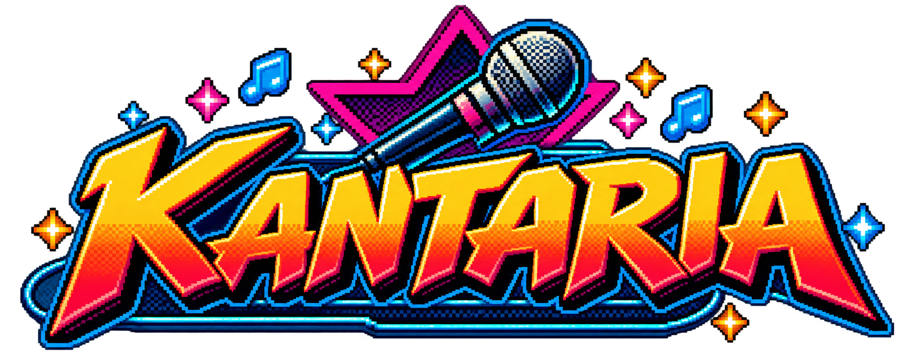
</p>

<p align="center">
  <b>Sing like nobody's listening. We're keeping score.</b>
</p>

<p align="center">
  Local karaoke for Windows, compatible with UltraStar songs.<br>
  Real-time pitch scoring, up to four microphones at once. No account, no cloud, no internet.
</p>

<p align="center">
  
  
  
  
</p>

---

## What is it?

Kantaria is a desktop karaoke app built with C# / .NET 10 / WPF for singing at home with friends. It reads songs in
**UltraStar** format (`.txt` + audio and, optionally, video), scores what you sing in real time and keeps each
player's history. Everything runs on your PC: no accounts, no cloud, no internet. No excuses.

It has its own 16-bit arcade-style interface, designed to look good on a big screen and to be driven with
keyboard, mouse or the optional remote control.

Kantaria can't teach you to sing. But it can document the attempt.

## Features

- **UltraStar song library** from the folders you choose. Your files are never modified. TXT, audio and optional video.
- **Real-time scoring** per beat, with pitch detection by YIN. Normal, golden, rap and freestyle notes, three
  difficulty levels and a line bonus.
- **Up to four microphones at once**, each with its own player, lane and on-screen input level.
  Four microphones, four chances to question your confidence.
- **Duets**, one voice per player.
- **Per-phrase messages** while you sing ("PERFECT!", "OOPS!"…), in Spanish and English, with variable wording.
- **Players, games, history and rankings** stored locally in SQLite. Your memory is selective. The database isn't.
- **Results with comments and characters**: each performance gets a verdict and a full-body character on stage.
- **Avatars**: pick one from the gallery or load your own, with face cropping.
- **Song queue** and a **preview** while browsing the library.
- **Background video** when the song includes one.
- **Interface music** (8-bit title and results themes, CC0) with its own volume, off at 0 %.
- **Audio**: Windows engine (WASAPI) or ASIO, with voice-delay latency calibration.
- **Optional remote control** through a local integration (named pipe, current user only), off by default.
  It is built for [Avyn](docs/AVYN_CONTRATO.md), a separate project.
- **Guest access over your LAN** (off by default): a QR on the main menu and the song list lets guests search songs,
  pick who sings (or create their own player with a name and a character) and add them to the queue from their phones. Nothing else. See [docs/INVITADOS.en.md](docs/INVITADOS.en.md)
  for how it works and its limits: plain HTTP on your local network, shared access key, no internet.

## Why does this exist?

Kantaria started because its author wanted a karaoke that worked properly with their own microphones.

Then came the scoring, the synchronization, the players, the rankings, the characters, the avatars, the
statistics and the remote control. At some point a fairly simple tool started turning into an arcade game.

There was no meeting where anyone approved this expansion. It just happened.

## Requirements

- Windows 10 or 11, 64-bit.
- One or more microphones to sing with (you can browse the library and look around without them).
- Your own songs in UltraStar format. Kantaria **does not include songs**. Musical talent is optional; a microphone helps.

## Screenshots

<table>
  <tr>
    <td width="50%" align="center"><a href="docs/screenshots/en/menu.png">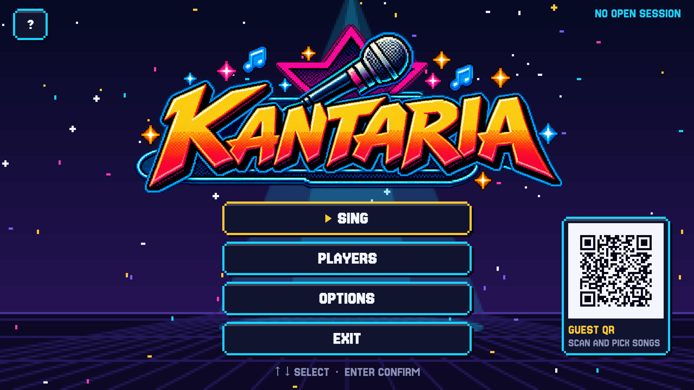</a><br><sub>Main menu</sub></td>
    <td width="50%" align="center"><a href="docs/screenshots/en/library.png">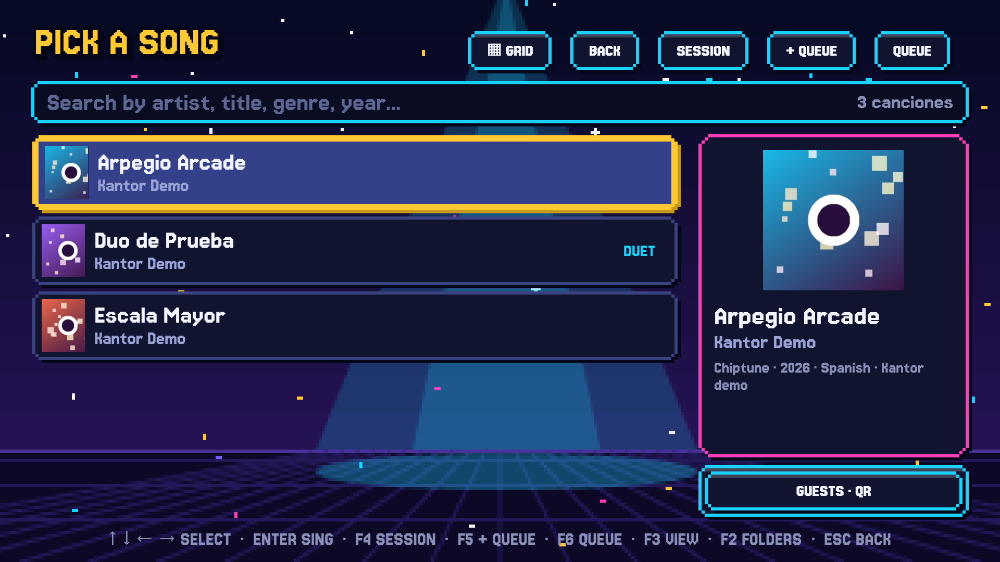</a><br><sub>Song library</sub></td>
  </tr>
  <tr>
    <td width="50%" align="center"><a href="docs/screenshots/en/who-sings.png">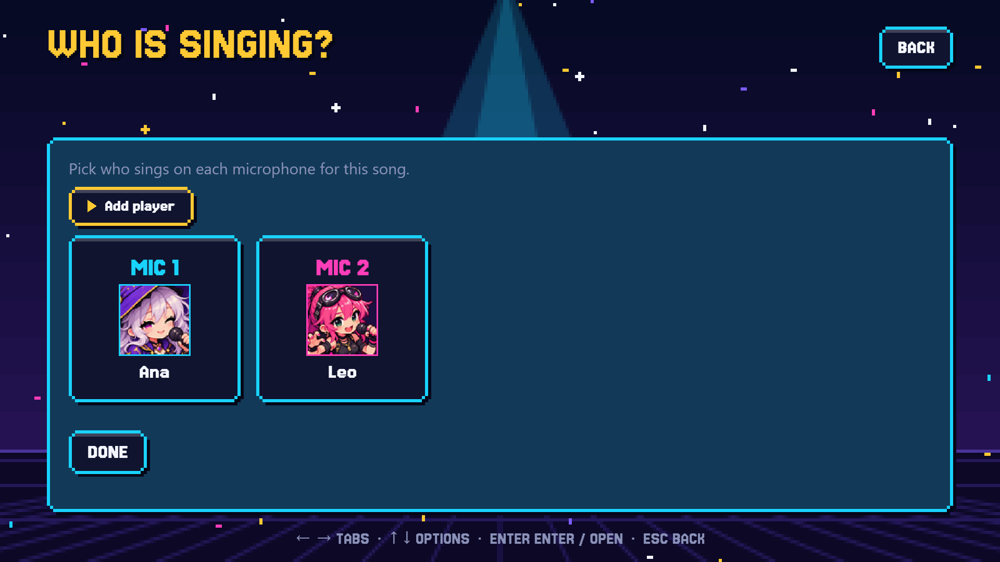</a><br><sub>Who sings on each microphone</sub></td>
    <td width="50%" align="center"><a href="docs/screenshots/en/stage.png">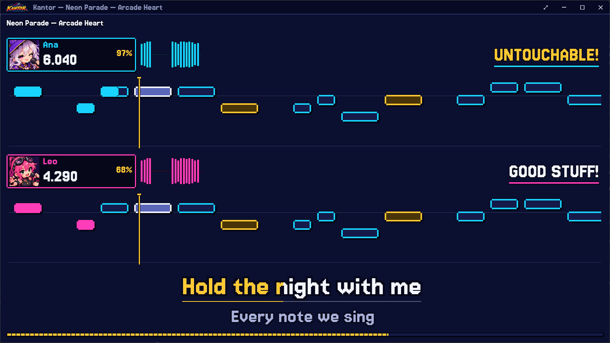</a><br><sub>Singing screen with per-phrase messages</sub></td>
  </tr>
  <tr>
    <td width="50%" align="center"><a href="docs/screenshots/en/results.png">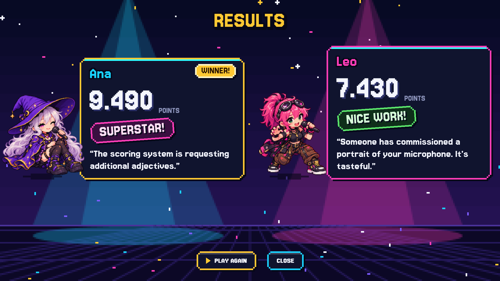</a><br><sub>Results with characters and verdicts</sub></td>
    <td width="50%" align="center"><a href="docs/screenshots/en/avatars.png">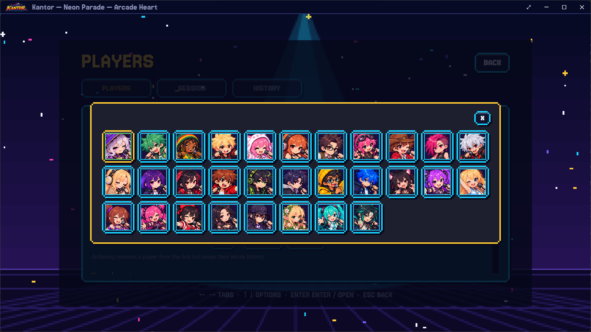</a><br><sub>Avatar picker</sub></td>
  </tr>
  <tr>
    <td width="50%" align="center"><a href="docs/screenshots/en/guests-library.png">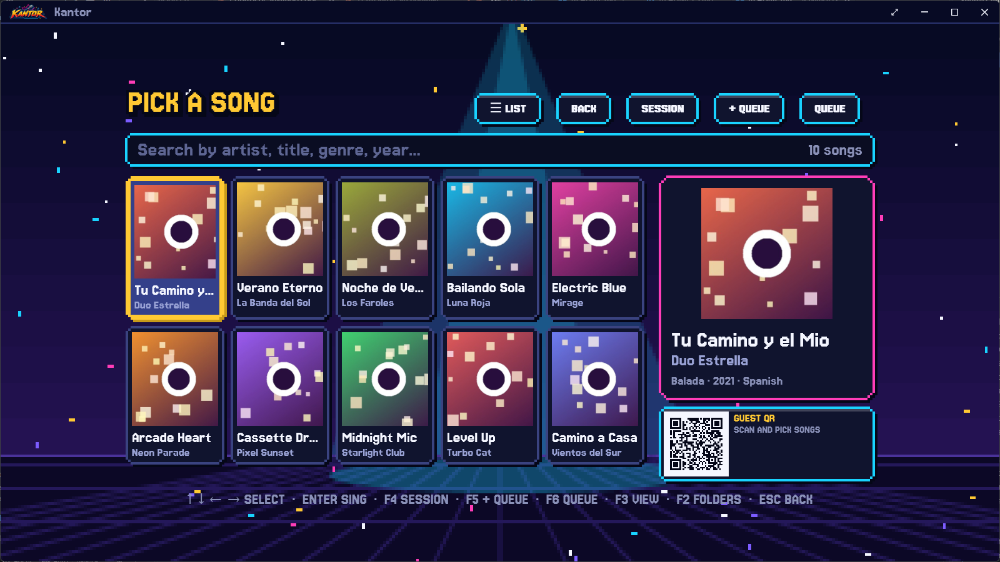</a><br><sub>Guest QR in the song list</sub></td>
    <td width="50%" align="center"><a href="docs/screenshots/en/guests-menu.png">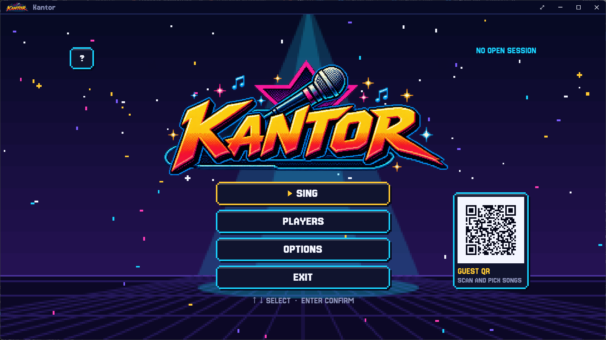</a><br><sub>Guest QR on the main menu</sub></td>
  </tr>
  <tr>
    <td width="50%" align="center"><a href="docs/screenshots/en/guests-phone-list.png">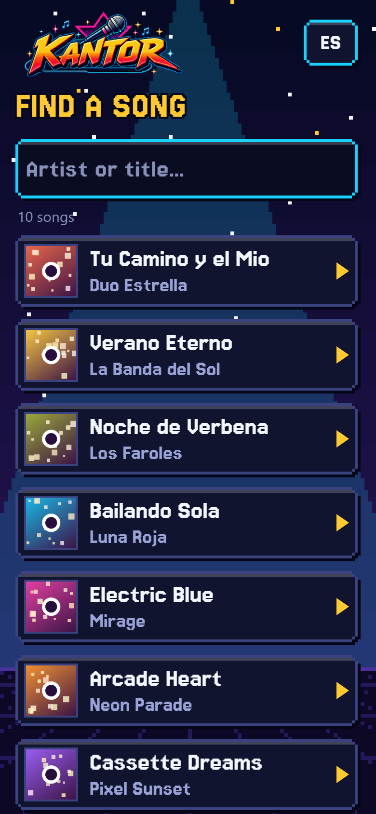</a><br><sub>On the phone: find a song</sub></td>
    <td width="50%" align="center"><a href="docs/screenshots/en/guests-phone-singers.png">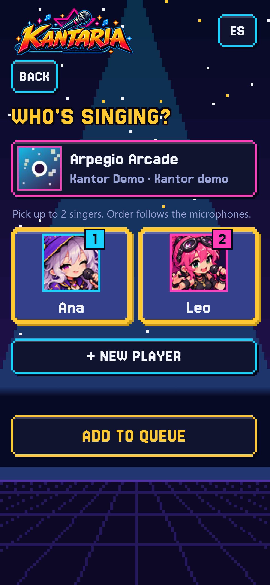</a><br><sub>On the phone: pick who sings</sub></td>
  </tr>
</table>

<sub>Click an image to see it full size. Screenshots use original demo songs, demo players and simulated singers.</sub>

## Download

**Microsoft Store:** <https://apps.microsoft.com/detail/9P8ZKZBJ4RHB> (updates automatically; includes a subset of the characters).

Other packages are published on [Releases](../../releases). You don't need to install .NET:

- **Installer** (`Kantaria-Setup-<version>.exe`): installs for the current user, no administrator rights, adds a
  Start menu entry and uninstalls from *Installed apps*. Running a newer installer over it updates Kantaria and keeps
  your data.
- **Portable** (`Kantaria-<version>-win-x64.zip`): extract it anywhere and run `Kantor.App.exe`.

> There is no published release yet; the Releases page will list it once there is one.
>
> The executable is not digitally signed, so Windows SmartScreen may show a warning the first time you run it.
> If you downloaded it from this repository's Releases page, choose "More info" → "Run anyway".

## Build from source

You need the [.NET 10 SDK](https://dotnet.microsoft.com/download).

```powershell
dotnet build Kantor.sln
dotnet test  Kantor.sln
dotnet run --project src/Kantor.App
```

To build the distributable packages (folder + zip in `dist\`, plus the installer with `-Installer`, which needs
[Inno Setup 6](https://jrsoftware.org/isinfo.php)):

```powershell
powershell -ExecutionPolicy Bypass -File scripts\publish.ps1 -Installer
```

The factory avatar PNGs are not in the repository: without them the app works and shows a generic avatar.
More details in [docs/DISTRIBUCION.md](docs/DISTRIBUCION.md).

## Documentation

The technical documentation is written in Spanish.

| Document | Contents |
|---|---|
| [docs/ESTADO.md](docs/ESTADO.md) | Project status, decisions, measurements, pending items and known pitfalls |
| [docs/PUNTUACION_WORLDPARTY.md](docs/PUNTUACION_WORLDPARTY.md) | How WorldParty scores and what Kantaria follows |
| [docs/DISTRIBUCION.md](docs/DISTRIBUCION.md) | How the package is built and the path to the Microsoft Store |
| [docs/AVYN_CONTRATO.md](docs/AVYN_CONTRATO.md) | Avyn remote control protocol |
| [docs/INVITADOS.en.md](docs/INVITADOS.en.md) | Guest access over the LAN: use, allowed actions, security and limits (English; Spanish: [INVITADOS.md](docs/INVITADOS.md)) |

## Support the project

Kantaria is free software made in spare time. If it brings you good karaoke nights and you want to help it keep growing, you can
sponsor the author on GitHub: <https://github.com/sponsors/pablopramparo>. It is entirely optional; everything in Kantaria works the same
without it.

## License and branding

Copyright (C) 2026 Pablo Pramparo

Kantaria's **code** is free software: you can redistribute it and/or modify it under the terms of the GNU General
Public License, version 3 or (at your option) any later version. It is distributed without any warranty.
See [LICENSE](LICENSE).

The **Kantaria name, its logo and its characters** are not covered by the GPL: they belong to the author and have no
reuse license. If you publish a fork, use a different name and replace those assets. Details in
[src/Kantor.App/Assets/LICENSE-ASSETS.md](src/Kantor.App/Assets/LICENSE-ASSETS.md).

Songs and media you use with Kantaria have their own licenses and are not included.

### Third-party components

The full list, with licenses, is in [THIRD-PARTY-NOTICES.md](THIRD-PARTY-NOTICES.md). In short:

- **Jersey 15** (typeface): SIL Open Font License 1.1.
- **LibVLC / LibVLCSharp** (background video): LGPL-2.1-or-later, as dynamic libraries.
- **NAudio**, **Microsoft.Data.Sqlite**: MIT. **SQLitePCLRaw**: Apache-2.0.

Kantaria is an independent project, inspired by UltraStar Deluxe and UltraStar WorldParty, with which it has no
official relationship.
